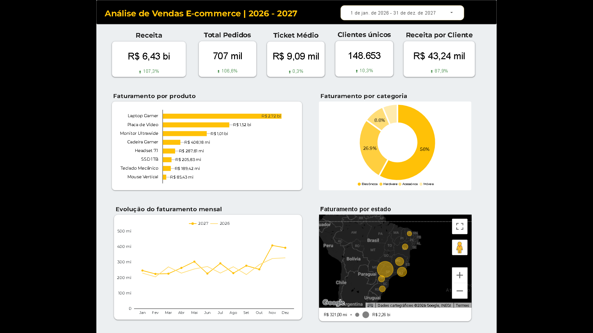

# 📊 Análise de Vendas E-commerce (2026–2027)

Projeto de análise de dados de ponta a ponta: **Python** para tratar e explorar os dados, **BigQuery** para armazenar e validar com SQL, e **Looker Studio** para o dashboard.

> ⚠️ **Dados fictícios.** O dataset é gerado em Python. Sazonalidade, variação entre meses, distribuição por estado e base de clientes foram **simuladas**.

🔗 **[Ver o dashboard no Looker Studio](https://datastudio.google.com/reporting/f73adc3c-2977-4112-83c5-cb828f7543a8)**



## O que o projeto responde

| Pergunta | Análise |
|---|---|
| O que vender? | Faturamento e quantidade por produto |
| Onde focar? | Faturamento por categoria |
| Quando agir? | Evolução mensal, comparando 2026 e 2027 |
| Para onde expandir? | Faturamento por estado |

## Principais resultados

- **707 mil pedidos** e **R$ 6,43 bi** de faturamento entre jan/2026 e dez/2027 (ticket médio de R$ 9,09 mil).
- **Eletrônicos e Hardware** somam cerca de 85% da receita. O **Laptop Gamer** é o produto que mais fatura (R$ 2,72 bi).
- **Acessórios** lideram em unidades vendidas (1,08 milhão), mas representam menos de 9% da receita. O faturamento é guiado pelo **preço**, não pelo volume.
- **Novembro e dezembro** são os meses mais fortes. 2027 faturou 7,3% a mais que 2026, mas em 4 meses (mar, jun, ago e out) 2026 foi melhor.
- **São Paulo** concentra 35% do faturamento, e o **Sudeste** (SP, RJ e MG) 68%.

## Como foi feito

1. **Geração dos dados** (`notebooks/geracao_dataset.ipynb`): cria o arquivo `vendas_raw.csv`.
2. **Tratamento e análise** (`notebooks/01_tratamento_eda.ipynb`): limpeza, coluna de faturamento, 7 análises com gráficos e carga no BigQuery.
3. **Validação em SQL** (`sql/validacoes.sql`): consultas que conferem os KPIs e gráficos do dashboard.
4. **Dashboard** no Looker Studio, conectado à tabela do BigQuery.

## Ferramentas

Python (Pandas, NumPy, Matplotlib, Seaborn) · Jupyter · BigQuery · SQL · Looker Studio

## Como reproduzir

```bash
pip install -r requirements.txt
```

1. Rode `notebooks/geracao_dataset.ipynb` para criar o `vendas_raw.csv` (os dados são sempre os mesmos, pois usam `seed`).
2. Rode `notebooks/01_tratamento_eda.ipynb`. A última parte (carga no BigQuery) exige um projeto próprio: troque o `PROJECT_ID`, crie o dataset `ecommerce_analytics` e autentique com sua conta Google.

## Autor

**vieirads99** · [LinkedIn](https://www.linkedin.com/in/juliovieiraa/) · [GitHub](https://github.com/vieirads99)
